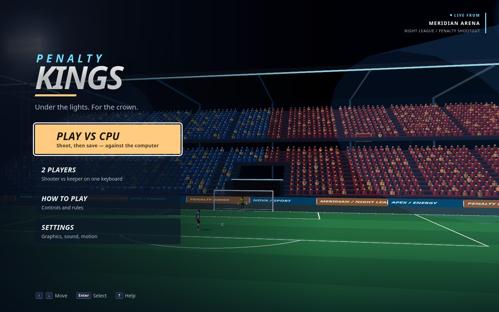
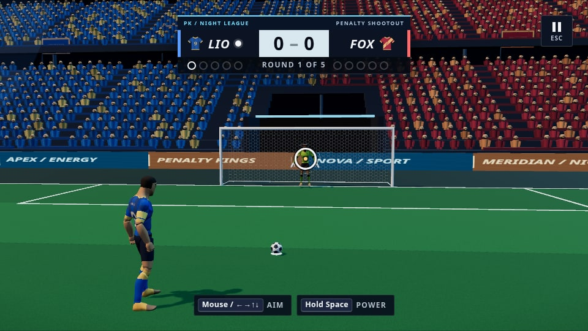
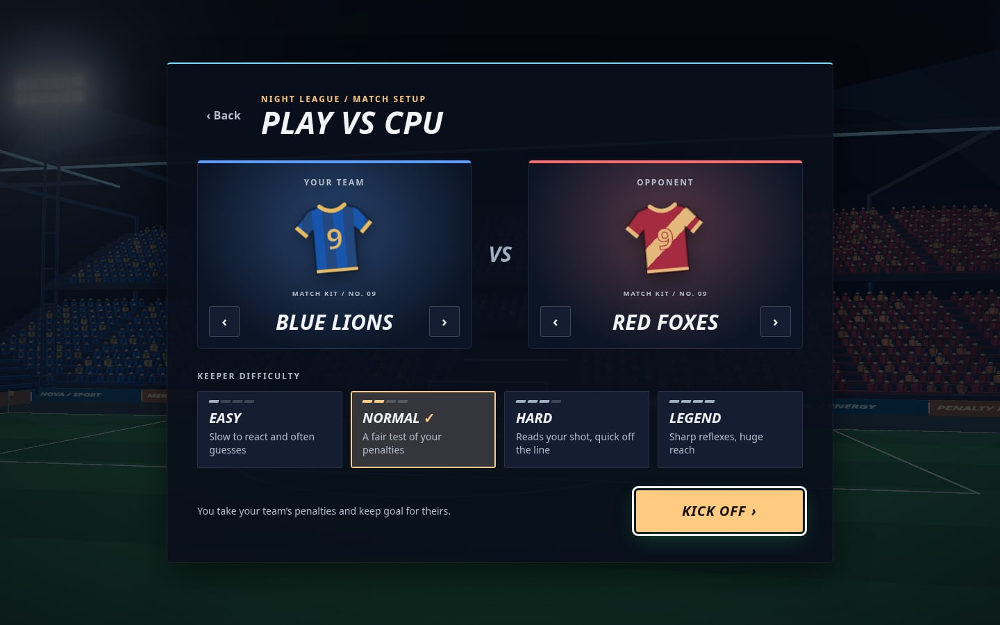
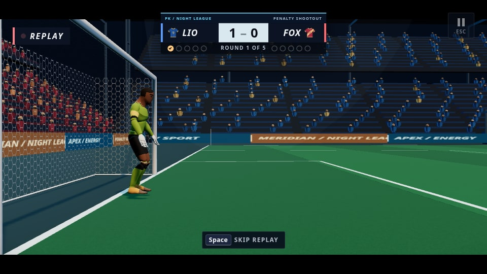
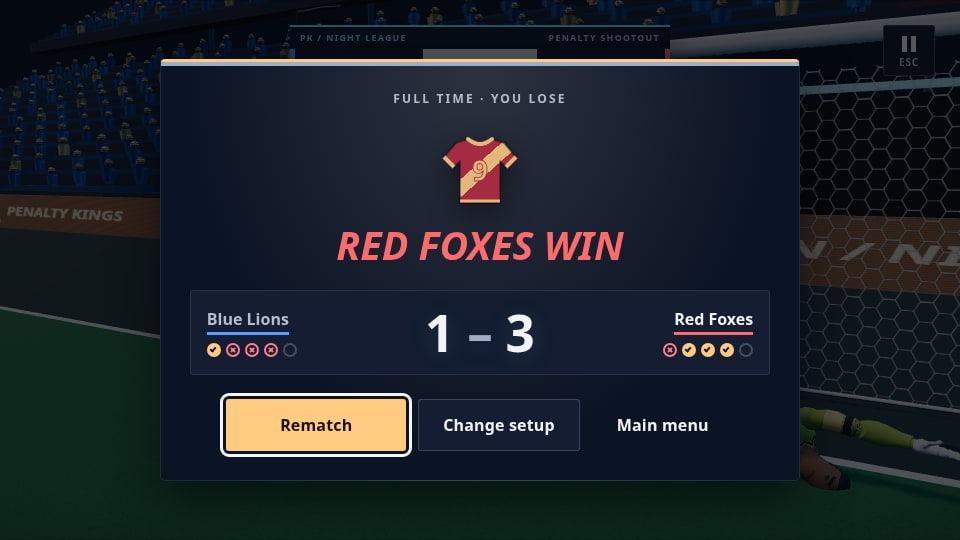

# Penalty Kings

A 3D football penalty shootout for desktop browsers (developed and tested in Chromium), built with Vite and Three.js. Take five penalties each against an AI goalkeeper (then sudden death), or play a friend on the same keyboard.





The **night league overhaul** replaces the photographic stadium with an original Draco-compressed 3D arena. See [before / after](docs/visual-overhaul.jpg), [visual and QA notes](docs/VISUAL-OVERHAUL.md), and the reversible choices in [DECISIONS.md](DECISIONS.md).

## Run it

```bash
npm install
npm run dev        # http://localhost:5173
npm run assets:stadium # reproducibly rebuild public/assets/models/stadium.glb (offline)
npm run build      # production build in dist/
npm run preview    # serve the build
npm test           # unit tests (rules, shot solver, Rapier physics, replay recorder)
```

Needs a current browser with WebGL 2. Developed and tested in Chromium; Safari 15+ should work (the High-quality post-processing falls back to direct rendering if float render targets are unavailable) but has not been tested here.

## How to play

**Taking a penalty** (aim → power → curve):

1. **Aim:** move the mouse (or drag on touch), or use the arrow keys.
2. **Power:** hold <kbd>Space</kbd> (or press and hold) and release. The red striped end of the bar skies the ball.
3. **Curve:** press again to stop the swinging marker. Curve bends the flight, not where it ends up.

**In goal:** the camera sits just inside your goal, behind the keeper. Click or tap where to dive (the screen maps onto the goal mouth; a gold marker follows the pointer), before the kick to guess or after it to react. Keys: <kbd>←</kbd>/<kbd>A</kbd> <kbd>→</kbd>/<kbd>D</kbd> low dive, <kbd>Q</kbd> <kbd>E</kbd> high dive, <kbd>↓</kbd>/<kbd>S</kbd> block, <kbd>↑</kbd>/<kbd>W</kbd> jump.

**2 players:** the shooter uses the mouse or arrows plus <kbd>Space</kbd>; the keeper uses <kbd>A</kbd> <kbd>D</kbd> <kbd>Q</kbd> <kbd>E</kbd> <kbd>S</kbd> <kbd>W</kbd>.

**Other keys:** <kbd>Esc</kbd>/<kbd>P</kbd> pause, <kbd>?</kbd>/<kbd>H</kbd> help, <kbd>Space</kbd> or click skips a replay.

**Rules:** five kicks each, the shootout ends early once one side cannot catch up, then sudden death in pairs.

**Settings** (saved in the browser): graphics quality (Low/High), master and crowd volume, mute, reduced motion, hints, auto replay. Difficulty (Easy, Normal, Hard, Legend) and teams are chosen on the match setup screen.

## Features

- Original 3D Meridian Arena: four-sided tiered stands, canopy roofs, four floodlight towers, light haze/glare, open tunnel, covered dugouts, corner flags, animated fictional LED sponsors and supporter banners. Full 68 × 105 m striped pitch with sharp line markings; a second imported goal completes the far end. No photographic background, real sponsors or crests.
- 9,600 instanced supporters on High; 2,400 spread over every stand on Low. GPU bob/wave/jump reactions and sparse camera flashes. Low retains the entire stadium.
- Imported CC0 ball, goal and Quaternius UAL characters. The match ball retains its source mesh with original ivory/navy panel paint; no photographic markings remain. Fictional patterned kits with names/numbers, captain band, socks/shin-pad seams, boots and gloves; painted eyes, brows, mouths, hair and two skin tones. The source Base Characters pack is absent, so the segmented mannequin silhouette remains a known limitation.
- Rapier physics with CCD ball, post/bar/net colliders, plus hand-written drag and Magnus (spin) forces. A shot solver aims the ball so the *predicted* line crossing hits your target; power overshoot and wobble are applied afterwards.
- Keeper dive, block and jump animations authored as keyframes (the library rig has none) and a keeper AI with per-difficulty reaction time, read error, guessing and reach.
- Cinematic cameras (aim, run-up, follow, reaction, keeper view, replay angles) driven by damped springs; hard cuts under reduced motion. Portrait projection keeps both posts, the striker and ball in view and clears the power panel.
- Goal and save effects: transparent curved streamer sprites, pooled sparks, interpolated ball trail, grass divots and a damped ripple on the imported net panels. Cool rim light, warm key, subtle floodlight bloom and automatic replay at 0.6× speed.
- Audio: CC0 impact and UI samples plus a synthesised crowd, cheers, groans and whistle.
- Ice/gold broadcast HTML/CSS over a live 3D menu: kit previews, named player intro lower-thirds, scoreboard with round dots, GOAL / SAVED / MISSED banners, labelled power/curve meters and a match-end scorecard. Keyboard and touch controls, visible focus, focus-trapped dialogs and reduced motion are retained. Reduced motion also freezes crowd/LED/banner motion and disables flashes, particles and net ripple.
- Performance: 60 fps target, resize and devicePixelRatio handling, resource disposal, Low quality mode, automatic downgrade when frames run slow.

## Stack

| | |
|---|---|
| Build | Vite 8, vanilla JavaScript (ES modules) |
| 3D | three 0.186 (GLTFLoader + DRACOLoader, GPU instancing, EffectComposer bloom, ACES tone mapping, sRGB) |
| Physics | `@dimforge/rapier3d-compat` |
| Asset tooling | `@gltf-transform/*` (dedupe, prune, resample, WebP textures, Draco) |
| Tests | `node:test`; Playwright is used for QA scripts but is **not** a project dependency |

## Project layout

```
src/
  main.js            app controller: loading, menu orbit camera, match lifecycle, settings
  assets/            manifest.js (single list of every asset) + loader with progress
  world/             scene construction, model fitting
  physics/           Rapier world, ball aerodynamics (drag, Magnus), crossing predictor
  game/              match state machine, shootout rules, shot solver, keeper AI, input, replay
  actors/            keeper and striker, authored clips and the pose converter
  camera/            camera director and shots
  fx/                particles
  audio/             sample playback and synthesised crowd
  core/              renderer, post-processing, quality presets, settings, perf, disposal
  ui/                screens/dialogs, HUD, toast
  styles/            tokens (palette, type scale), base, ui, hud, loading
public/assets/       models/ (including generated stadium.glb), audio/
scripts/             asset pipeline and QA scripts (below)
tests/               unit tests
docs/PLAN.md         the Phase 0 research and plan
```

## Swapping models

All loaded files are listed in `src/assets/manifest.js`; nothing else refers to file names.

1. Put the source GLB in `assets/raw/` (git-ignored) and run `npm run assets`. It optimises with Draco and WebP into `public/assets/models/`.
2. To **replace the goal**: save the new model as `assets/raw/goal/goal.glb`, run `npm run assets`. It is scaled to the 7.56 m outer width and slid back so the front of the posts sits on the goal line (z = 0). It must open towards +z (net towards -z); rotate it in `src/world/scene.js` otherwise. The physics goal (`GOAL` in `src/game/shot.js`: posts, bar, net depth 1.5 m) should match the model. The shipped goal came from a Blender file via `scripts/convert-goal-blend.py`. The required authored stadium is rebuilt with `npm run assets:stadium`; its meshes are already in pitch coordinates. See docs/VISUAL-OVERHAUL.md before replacing it (crowd/ribbon/banner names are runtime hooks).
3. To **replace the ball or character**, overwrite `ball.glb` / `character.glb`. The character must be a skinned humanoid with the Quaternius UAL bone names; kit painting assumes the shipped 1.83 m bind pose, so adjust `kit.js` for a different mesh. The ball receives original panel paint in `src/world/ball-style.js`. The dive, block, jump and kick clips are authored per bone in `src/actors/clips.js` and mapped by `src/actors/pose.js`.
4. Target real-world sizes live in `TARGET_SIZE` in the manifest.

Keep each model under about 5 MB.

## Developer tools

| Tool | Use |
|---|---|
| `?debug` | draws every Rapier collider |
| `?stats` | FPS, draw calls, triangles, geometries and textures |
| `?play` | skip the menu (dev server only); also `&mode=2p&difficulty=hard` |
| `?timescale=4` | fast-forward the simulation (dev server only) |
| `?pose=low&side=1&t=0.4` | freeze a keeper/striker pose for inspection (dev server only) |

QA scripts (need the dev server running and Playwright available in the execution environment: `CHROMIUM_PATH=/usr/bin/chromium node scripts/<name>.mjs`; see the exact commands and optional global `NODE_PATH` setup in `docs/VISUAL-OVERHAUL.md`):
`visual-qa` (full visual walkthrough), `layout-check` (nine desktop, tablet, phone and landscape viewports), `overhaul-check` (crowd density, assets, motion, animation bindings and net impact), `perf-measure` (software frame cost), `smoke-test` (loader and scene; use the normal game URL when Khronos test models are absent), `play-test` (a full shootout), `ui-tour` (every screen, keyboard only), `responsive-shots` (tablet/phone and touch), `audio-test`, `leak-test` (GPU resources across matches), `balance` (AI save rates).

## Screenshots and verification







Screenshots are actual Chromium software-rendered captures. They differ from a real GPU, especially bloom and frame rate. The 60 fps hardware target requires a real GPU measurement; see [the QA record and exact commands](docs/VISUAL-OVERHAUL.md).

## Credits

See [CREDITS.md](CREDITS.md) for every asset with author, licence and URL.
